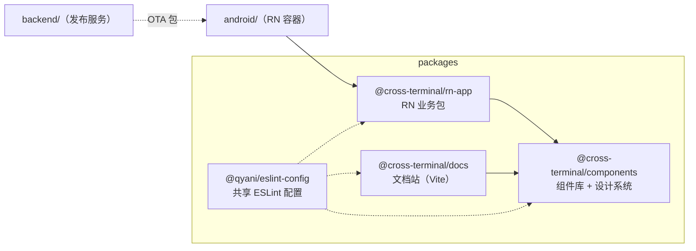

# 跨端容器前端（Cross-terminal Frontend）

一个 **RN 业务包 + 跨端组件库 + 组件文档站** 的 pnpm monorepo：

- 同一份组件代码，**Android（RN 原生）和 Web（react-native-web）都能跑**；
- 设计系统分**原子层 / 语义层 / 组件层**，支持 **7 套主题运行时切换**；
- 提交有 **ESLint + Prettier + 单测** 三道门禁，提交信息强制 `[改动][影响] 摘要` 格式。



## 技术栈

| 领域   | 选型                                                                                |
| ------ | ----------------------------------------------------------------------------------- |
| 包管理 | pnpm 10 workspaces                                                                  |
| 语言   | TypeScript 5.9（strict）                                                            |
| 跨端   | React Native 0.87 + react-native-web 0.21                                           |
| UI     | React 19（`<Context value>` / `use()`）                                             |
| 图标   | react-native-svg 15                                                                 |
| 构建   | Metro（原生）/ Vite 8（Web、文档站）                                                |
| 测试   | Jest 29 + React Native Testing Library 13                                           |
| 质量   | ESLint 10（flat config，React Compiler 规则全开）+ Prettier 3 + husky + lint-staged |

## 目录结构

```text
.
├── packages/
│   ├── components/          # 组件库（QButton / QIcon / QHotzone + 设计系统）
│   ├── rn-app/              # RN 业务包（Android 容器加载它；同时可跑 Web）
│   ├── docs/                # 组件文档站（实时预览 + 属性面板 + 主题/热区开关）
│   └── eslint/              # 共享 ESLint flat config（@qyani/eslint-config）
├── android/                 # Android 容器壳（Kotlin，加载 RN bundle）
├── ios/ harmony/ miniprogram/  # 预留的各端壳工程
├── backend/                 # 发布服务（OTA manifest / 产物）
├── scripts/                 # 构建 / 发布 / commit-msg 校验脚本
├── COMPONENT.md             # 组件 API 规格（唯一权威的接口定义）
├── PLAN.md / ROADMAP.md     # 计划与路线图
└── AGENTS.md                # 给 AI 编码代理的项目说明
```

## 快速开始

```powershell
# 1. 安装（会通过 prepare 自动装 husky 钩子）
pnpm install

# 2. 组件文档站（推荐先看这个）
pnpm docs:dev            # http://localhost:5174

# 3. RN 原生（需要先 `pnpm start:rn` 起 Metro，再用 Android Studio 跑 android/）
pnpm start:rn

# 4. RN Web
pnpm start:web
```

## 常用命令

| 命令                                   | 作用                                            |
| -------------------------------------- | ----------------------------------------------- |
| `pnpm docs:dev` / `pnpm docs:build`    | 文档站开发 / 构建                               |
| `pnpm start:rn` / `pnpm start:web`     | RN 原生 Metro / RN Web                          |
| `pnpm build:web` / `pnpm build:bundle` | Web 产物 / RN bundle                            |
| `pnpm publish:bundle`                  | 上传 bundle（OTA）                              |
| `pnpm typecheck`                       | 全工作区 `tsc --noEmit`                         |
| `pnpm lint` / `pnpm lint:fix`          | ESLint                                          |
| `pnpm format` / `pnpm format:check`    | Prettier                                        |
| `pnpm check`                           | **typecheck + lint + format:check**（提交前跑） |
| `pnpm -r run test`                     | 全部单测                                        |

## 质量门禁

提交时自动执行（`.husky/pre-commit`）：

1. **ESLint**：只对暂存文件，`--fix --max-warnings=0`（0 warning 才放行）；
2. **Prettier**：只对暂存文件，自动写入；
3. **单测**：组件库 Jest + 共享配置包自检。

提交信息校验（`.husky/commit-msg`）——**必须是**：

```text
[type][change] 改了什么 [effect] 影响哪些

# 例：
[feat][change] 新增 QHotzone 热区开关 [effect] 文档站、全部示例
[refactor][change] 设计系统改为三层字典 [effect] 全部组件、主题 API
[test][change] 补主题覆盖用例 [effect] components 单测
[docs][change] 补充提交信息规范 [effect] README、AGENTS.md
```

- **`type` 必须在白名单内**：`feat | fix | test | docs | refactor | style | perf | build | ci | chore | revert`
- `[change]` 后面写**具体改了什么**
- `[effect]` 后面写**影响哪些**（包 / 组件 / 文档 / `none`）
- 首行 ≤ 120 字符；合并、回滚、`fixup!`/`squash!` 自动放行
- 规则实现：`scripts/verify-commit-msg.mjs`

> 紧急情况可用 `git commit --no-verify` 跳过，但**不要**在 CI 上依赖它。

## 设计系统（简版）

```text
primitive.ts（原子层，一个巨大字典：颜色 / 字号 / 行高 / 间距 / 圆角 / 描边）
      ↓ 颜色写点分字符串，运行时解析
semantic.ts（语义层：brand / text / status / background / stroke + 字体角色）
      ↓
components/<组件>.ts（组件层：几何直接写数值，颜色写字符串）
```

- `theme.ts` 在运行时把字符串解析成值，并叠加主题与覆盖；
- 内置 7 套主题：`yellow`（默认）/ `orange` / `pink` / `blue` / `red` / `brown` / `green`；
- 组件里用 `useThemeConfig(theme?, componentName, overrides?)` 取 `{ theme, global, tokens }`。

细节见 [`packages/components/README.md`](./packages/components/README.md)。

## 文档站部署（GitHub Pages）

仓库已带 `.github/workflows/deploy-docs.yml`：推送到 `main`（改了 `packages/docs/**` 或组件库源码）
或手动触发，就会构建并部署到 GitHub Pages。

1. 推到 GitHub；
2. 仓库 **Settings → Pages → Source** 选 **GitHub Actions**（只需做一次）；
3. 地址：`https://<owner>.github.io/<repo>/`。

> 项目页在子路径下，所以 CI 会给 `pnpm docs:build` 传 `DOCS_BASE=/<repo>/`（Vite `base`）。
> 用自定义域名时把它改成 `/`。细节见 [`packages/docs/README.md`](./packages/docs/README.md)。

## 文档索引

| 文档                                                               | 内容                                         |
| ------------------------------------------------------------------ | -------------------------------------------- |
| [`COMPONENT.md`](./COMPONENT.md)                                   | 43 个组件的 API 规格（组件库的权威接口定义） |
| [`packages/components/README.md`](./packages/components/README.md) | 组件库实现约定、设计系统、图标架构、已知偏差 |
| [`packages/rn-app/README.md`](./packages/rn-app/README.md)         | RN 包 / Metro / Web 双端说明                 |
| [`AGENTS.md`](./AGENTS.md)                                         | AI 编码代理的开工须知（约束、坑、命令）      |
| [`ROADMAP.md`](./ROADMAP.md) / [`PLAN.md`](./PLAN.md)              | 路线图与计划                                 |

## 约定速览

- 组件导出带 `Q` 前缀，**目录名小写**（`src/button/`）；
- 组件的 `style.ts` 是**唯一读主题处**，实现文件不直接引 `primitive` / `semantic`；
- 每个组件三件套测试：`props/*.cases.ts`（纯数据）、`*.snapshot.test.tsx`、`*.interaction.test.tsx`；
- 原生壳（`android/` 等）不是 JS 项目，不参与 ESLint / Prettier。
